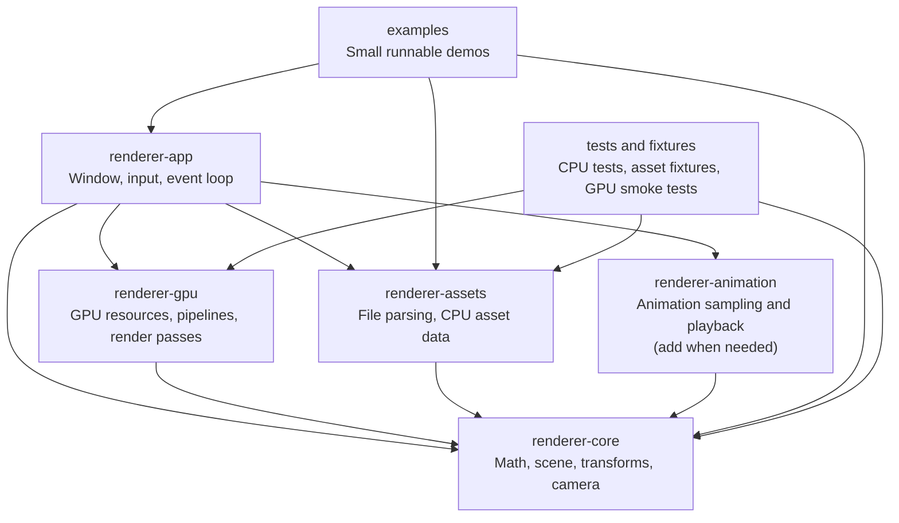
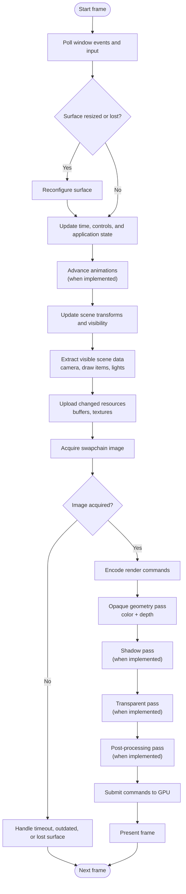

## General architecture

Keep CPU-side data separate from GPU state, and make crate dependencies flow toward rendering and the app:



**Responsibilities and boundaries**

- **`renderer-core`** owns GPU-independent scene and rendering concepts: transforms, cameras, mesh/material descriptions, and handles or IDs. It should be straightforward to unit-test without opening a window or initializing a GPU.
- **`renderer-assets`** parses files into CPU-side asset data. It reports unsupported or malformed content explicitly and does not create GPU resources.
- **`renderer-gpu`** owns the `wgpu` instance/device/surface, GPU resource uploads, pipelines, and render passes. It consumes scene data but should not own the app’s event loop.
- **`renderer-app`** connects windowing and input to the engine: it runs the frame loop, routes input, and coordinates scene updates and rendering.
- **`renderer-animation`** is optional early on. Add it when animation sampling and playback warrant a separate crate; it should update core scene state, not issue GPU commands.

A typical dependency direction is:

```text
renderer-app → renderer-assets, renderer-animation, renderer-gpu
renderer-assets → renderer-core
renderer-animation → renderer-core
renderer-gpu → renderer-core
```

Avoid circular dependencies. In particular, keep parsed asset data and scene types independent of `wgpu` objects; the renderer can turn CPU data into GPU resources when loading or when a resource is first needed.

## Render cycle



The early version can omit animation, shadows, transparency, and post-processing: update a static scene, extract a few draw items, acquire the surface image, draw a triangle or cube, submit, and present. Add passes when a feature needs them, while keeping the frame’s inputs and outputs explicit.
